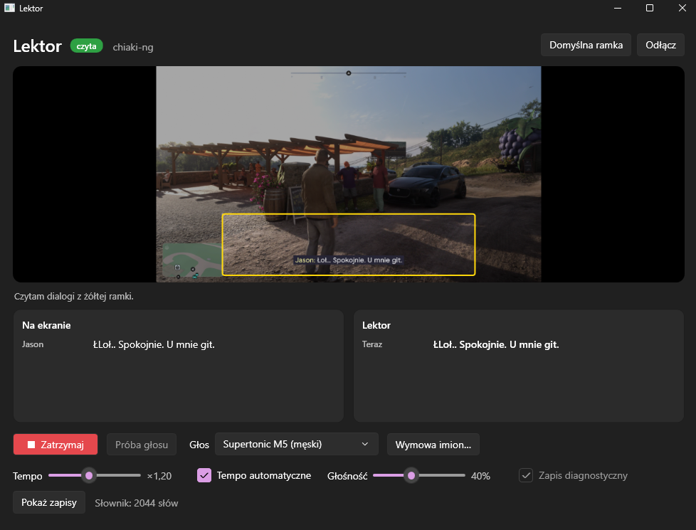

# POLSKI PL Lektor do gry GTA VI (PS5/PS5 PRO/XBOX) 

Darmowa aplikacja BEZ INSTALACJI na Windows'a, która dodaje PL lektora do PL napisów dialogowych w GTA VI. Aplikacja rozpoznaje napisy w wybranym oknie i czyta je zainstalowanym głosem. Rozpoznawanie tekstu i synteza mowy działają lokalnie na komputerze - OFFLINE. Model trenowany na RTX5090.

Głos powstaje na bieżąco z polskich napisów dialogowych.

[**Pobierz Lektora na Windows (ZIP)**](https://github.com/RECaiBK/polski-lektor-gta-vi/releases/download/v1.0/Lektor-GTA-VI-1.0-Windows-x64.zip)

**PL Lektor GTA VI**

https://github.com/user-attachments/assets/c063dda8-ba3e-40f8-b886-035efca702b0

## Co daje Lektor

- **Czyta same kwestie dialogowe.** Pomija etykiety z imionami mówiących, napisy pomocnicze, cele misji, podpowiedzi i szyldy, także gdy pojawią się w żółtej ramce.
- **Automatycznie dopasowuje tempo.** Krótkie kwestie czyta spokojniej, a dłuższe szybciej, żeby skończyć przed zniknięciem napisu. Tempo możesz też ustawić ręcznie.
- **Uczy się słów podczas gry.** Uzupełnia lokalny słownik słowami rozpoznanymi w napisach i korzysta z niego, żeby poprawiać kolejne odczyty.
- **Pozwala dopasować głos.** Możesz odsłuchać próbkę głosu, ustawić głośność i poprawić wymowę imion, które padają w dialogu.
- **Zmiana imion.** Jak to synteza offline, imiona typu "Jason" czyta jak widzi. W aplikacji możemy nadać instrukcję by "Jason" czytał "Dżejson" itp.

W dotychczasowych testach Lektor rozpoznawał dialogi z dużą skutecznością przy polskich napisach z imionami mówiących i ciemnym tłem.

## Wersja 1.0

Paczka `Lektor-GTA-VI-1.0-Windows-x64.zip` zawiera aplikację dla Windows 10 (wersja 2004 lub nowsza) i Windows 11, w wersjach 64-bitowych.

Lektor działa z PS5, PS5 Pro i Xbox Series X|S. Potrzebujesz komputera z Windows i okna z obrazem gry z konsoli. Włącz w grze polskie napisy, imiona mówiących i najciemniejsze tło napisów.

## Uruchomienie

1. Rozpakuj ZIP i uruchom `Lektor.exe` z folderu `Lektor/Lektor`.
2. Uruchom na komputerze grę zdalną i połącz się z konsolą. Do połączenia z PS5 lub PS5 Pro możesz użyć chiaki-ng albo PS Remote Play.
3. Wybierz w Lektorze okno z obrazem gry i ustaw żółtą ramkę na swoim obszarze napisów (nie na styk, zachowaj zapas).
4. Kliknij **Czytaj** lub naciśnij spację - GOTOWE.

Pełna instrukcja jest w pliku `CZYTAJ-MNIE.txt` w paczce.
Odczyt może czasami przekręcić słowo/imię lub pominąć jakąś kwestię.

## Warunki i licencje

Warunki korzystania opisuje plik `WARUNKI.txt`.
Licencje dołączonych komponentów są w folderze `licencje`.

Jest to niezależny projekt.

# Wsparcie

## Jeśli Lektor Ci się przydaje i chcesz wesprzeć jego rozwój, możesz [postawić mi kawę ☕](https://buycoffee.to/recai).
